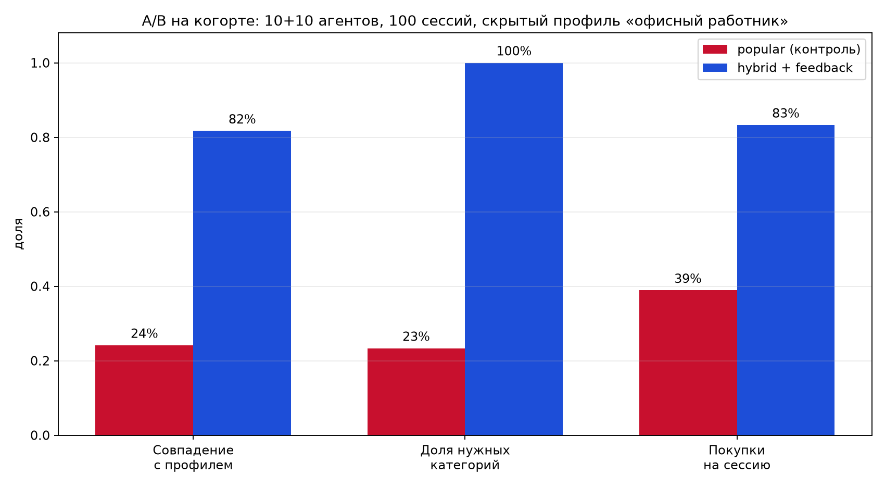
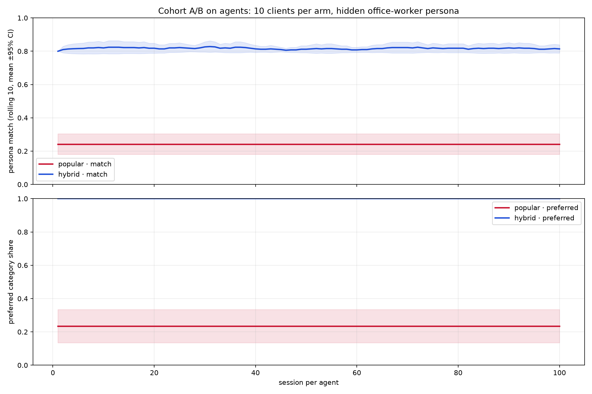

# A/B на когорте агентов: скрытый профиль «офисный работник»

Дата: 26.11.2026.  
Данные: обезличенный датасет организаторов + синтетические агенты.  
Профиль не передаётся в рекомендательную систему — она видит только `client_id`, покупки и события.

## 1. Что проверяли

Гипотеза: если у клиента есть типовой профиль, рекомендательная система может подстроиться под него по поведению и выдавать не случайные, а релевантные товары.

Проверка — не на людях, а на агентах:

- 20 синтетических клиентов;
- у всех один скрытый профиль «офисный работник»;
- у каждого своя история и свои события;
- 100 сессий на агента;
- A/B: 10 агентов в контроле, 10 в адаптивной группе.

## 2. Скрытый профиль

| Параметр | Значение |
|---|---|
| Роль | офисный работник / бухгалтер |
| Аудитория | B2B |
| Интересы | Office, PDF, обучение, backup, безопасность |
| Избегает | игры, графику, CAD |
| Стартовая история | Microsoft Office 2024 для дома и учёбы |
| Что видит система | только историю, показы, клики и покупки |

Профиль **не отправляется** в API. Агент использует его только для решения «кликнуть / купить / пропустить».

## 3. Дизайн A/B

| Плечо | Что внутри | Агентов | Сессий |
|---|---|---:|---:|
| Контроль | `popular`, без адаптации | 10 | 100 |
| Тест | `hybrid + feedback + exploration` | 10 | 100 |

Метрики:

- **match** — среднее совпадение топ-3 со скрытым профилем, 0–1;
- **preferred share** — доля карточек в предпочтённых категориях;
- **покупки на сессию** — доля сессий, где агент совершил покупку;
- **клики** — доля сессий с кликом.

## 4. Результаты

| Метрика | popular | hybrid + feedback | Разница |
|---|---:|---:|---:|
| Совпадение с профилем | **24%** | **82%** | ×3.4 |
| Доля нужных категорий | **23%** | **100%** | ×4.3 |
| Покупки на сессию | **39%** | **83%** | ×2.1 |
| Клики | 67% | 90% | +23 п.п. |





## 5. Что это значит

- Для офисного работника популярность ошибается: в топ попадают devtools/backup/analytics, а не Office/PDF/обучение.
- Адаптивная система после кликов и покупок выходит на **100% предпочтённых категорий**.
- Покупки растут **в 2.1 раза** в симуляции.
- Это не «магия LLM»: работают граф связей, правила, feedback и exploration.

## 6. Офлайн-бэктест на датасете

| Группа | Baseline Precision@3 | Наша модель |
|---|---:|---:|
| B2B A | 3.6% | **9.9%** |
| B2B B, холодный старт | 5.1% | **12.3%** |
| B2C A | 19.4% | 19.4% |
| B2C B | 19.2% | 19.2% |


Вывод: на B2B модель примерно в 2.4–2.7 раза лучше baseline; на B2C не теряем. B2C-выборка маленькая, выводы по ней осторожные.

## 7. Ограничения

- Это **агенты**, не реальные пользователи.
- Профиль и вероятности покупки заданы нами; это проверка механизма, а не доказательство рынка.
- Каталог в демо синтетический; на реальном каталоге цифры изменятся.
- Для продажи заказчику нужен пилот на реальном трафике с контрольной группой.

## 8. Следующий шаг

1. Прогнать 3 профиля: офисный работник, Go-разработчик, дизайнер/студент.
2. Показать, где адаптация даёт uplift, а где популярность уже достаточна.
3. Запустить пилот на реальном трафике:
   - контроль — текущая выдача;
   - тест — hybrid + feedback;
   - метрики: conversion, attachment rate, выручка на 1000 показов, Fill Rate.
4. После 4–6 недель — бизнес-кейс для заказчика.

## 9. Воспроизведение

```bash
cd /home/basili4/GolandProjects/lk-advisor
python3 analysis/office_cohort_ab.py
python3 analysis/make_cohort_summary.py
```

Скрипт сам сбрасывает тестовых клиентов и пересоздаёт demo-seed после прогона.

## 10. Для презы — три сообщения

1. **Профиль скрыт, система учится по поведению.** Это честный тест, а не подгонка.
2. **На когорте 10+10 адаптация даёт 82% match и 100% нужных категорий против 24% и 23% у популярности.**
3. **Покупки в симуляции растут в 2.1 раза.** Это основа для пилота и бизнес-кейса.
