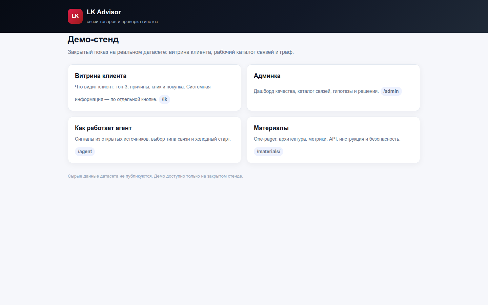
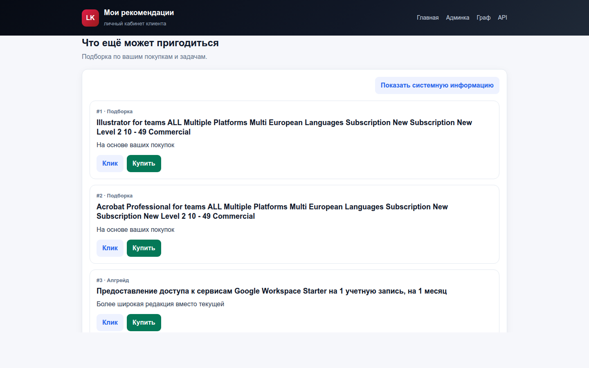
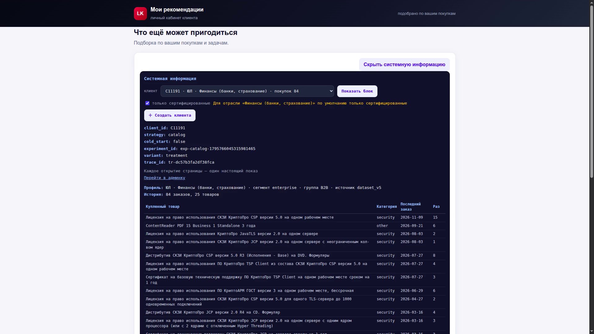
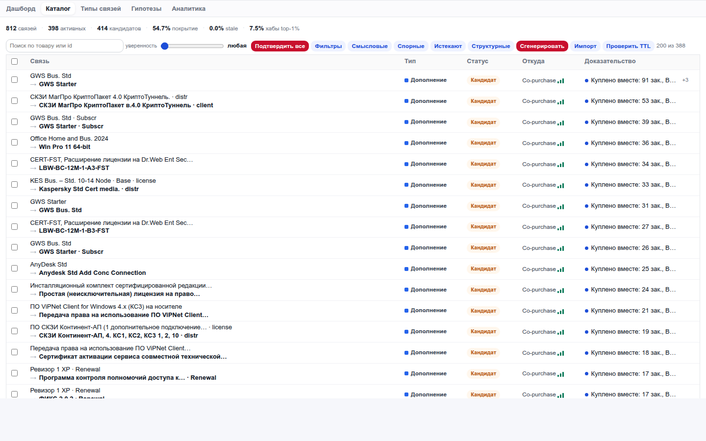
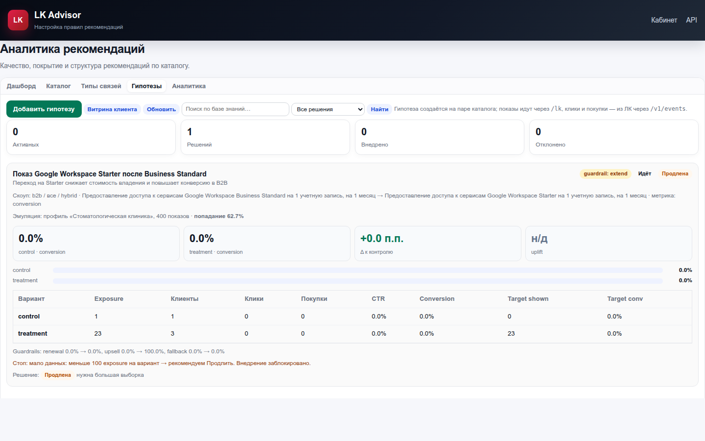
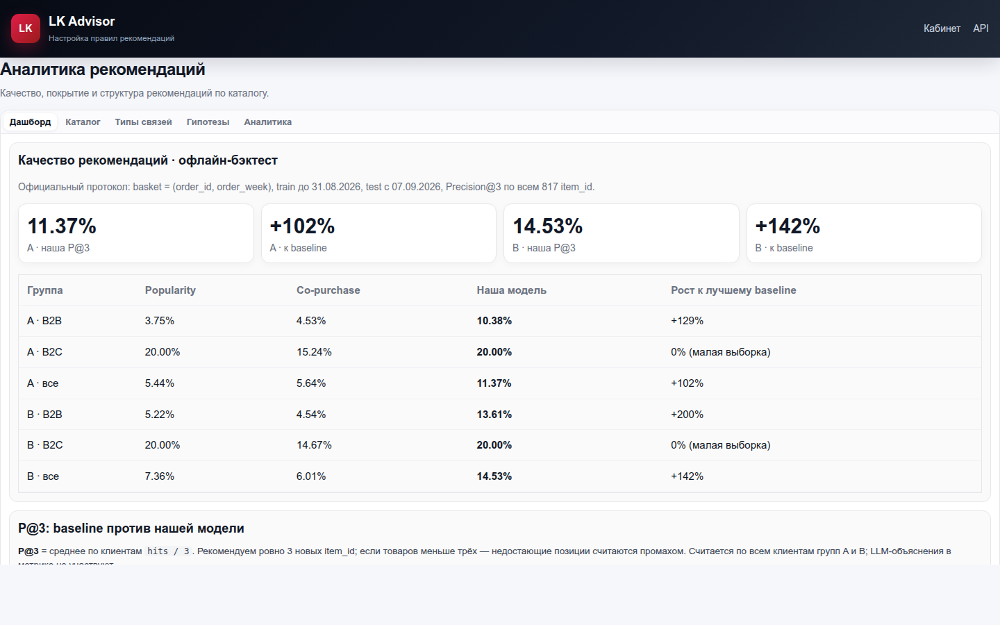
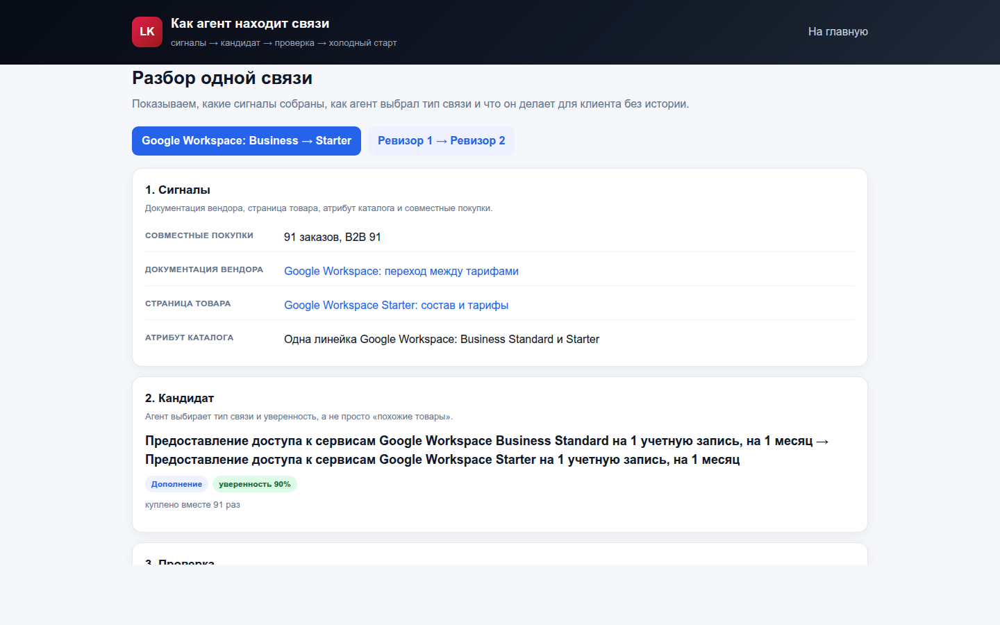

# LK Advisor — инструкция пользователя

Демо-стенд: **https://taskino.online**

Разделы:

- `/lk` — витрина клиента;
- `/admin` — админка: дашборд, каталог связей, гипотезы, аналитика;
- `/demo/graph` — граф связей;
- `/agent` — как работает агент;
- `/video/` — демо-видео на 3 минуты.

## 1. Главная

С главной открываются все разделы. Сырые данные датасета наружу не отдаются.

## 2. Витрина клиента

Откройте `/lk` — это то, что видит клиент: три товара и причина, почему каждый здесь.

1. Нажмите **«Показать системную информацию»** справа над блоком.
2. В панели выберите клиента: `C05445`, `C11191` или `COLD-RETAIL`.
3. Нажмите **«Показать блок»**.
4. На карточке доступны **«Клик»** и **«Купить»** — события запишутся отдельно, появится отметка «Клик записан».
5. Рядом с товаром — человеческая причина: «На основе ваших покупок», «Апгрейд» и т.п.

В системной панели видно служебное: `client_id`, стратегию, `experiment_id`, вариант, `trace_id`, профиль и историю покупок.

### Сертификаты

Для регулируемых отраслей, например финансов (`C11191`), галочка **«только сертифицированные»** включается автоматически, рядом появляется подсказка. Если снять галочку — в блоке появятся обычные товары.

### Создать клиента

1. В системной панели нажмите **«＋ Создать клиента»**.
2. Заполните: ID (необязательно), тип (ЮЛ/ИП/ФЛ), отрасль, сегмент (`small`, `medium`, `corporate`, `enterprise`), группу.
3. Нажмите **«Создать»**.
4. Новый клиент без истории получит холодный старт — популярные товары. Нажмите **«Показать блок»**.

## 3. Построить новую связь

### Вариант А — агент

1. Откройте `/admin` → вкладка **«Каталог»**.
2. В блоке **«Агент разметки»** выберите **«Откуда (куплено)»** и **«Куда (предлагаем)»**.
3. Нажмите **«Предложить связь»**.
4. Агент вернёт тип, уверенность, причину и доказательства.
5. Решение по уверенности:
   - **85% и выше** — «принята автоматически»;
   - **70–85%** — «кандидат · нужна проверка»;
   - **ниже 70%** — карантин.
6. Нажмите **«Добавить в граф»** (для автоматически принятой) или **«Добавить как предложение»** / **«Добавить и подтвердить»**.

### Вариант Б — вручную

1. `/admin` → **«Каталог»** → форма **«Новая связь»**.
2. Укажите **Откуда**, **Куда**, **Тип связи**, **Уверенность, %** и **Статус**.
3. Нажмите **«Сохранить»**.

### Проверка и доказательства

- Фильтры: **«Смысловые»**, **«Спорные»**, **«Истекают»**, **«Структурные»**.
- Ползунок уверенности и поиск по товару.
- Откройте связь — увидите статус, уверенность и блок **«Доказательства»**: co-purchase, документация вендора, страница товара, атрибут, ФСТЭК.
- Чекбоксы и **«Подтвердить все»** — массовая проверка.
- **«Сгенерировать»** — кандидаты из внешних источников, **«Импорт»** — загрузка, **«Проверить TTL»** — перепроверка устаревших.
- Любую связь можно удалить: в карточке связи есть удаление.

## 4. Запустить гипотезу

1. `/admin` → вкладка **«Гипотезы»**.
2. Нажмите **«Добавить гипотезу»**.
3. Выберите источник и цель (можно фильтровать по названию), тип связи, аудиторию B2B/B2C, отрасль.
4. Укажите метрику (`conversion`), traffic split (например, 50/50) и guardrails: `renewal`, `upsell`, `fallback`.
5. Название и формулировка генерируются автоматически — их можно переписать.
6. Нажмите **«Создать гипотезу»**. Гипотеза сразу становится экспериментом со статусом «Идёт».

Дальше:

- показы создаются реальным открытием `/lk`, клики и покупки — кнопками на карточках;
- на карточке гипотезы видно exposure, клиентов, клики, покупки, CTR, conversion, target shown / target conv;
- **«Прогнать на эмуляторе»** — прогноз на профиле клиента без живого трафика;
- при малой выборке guardrail предлагает **«Продлить»**, внедрение блокируется;
- решения «Внедрить» / «Отклонить» уходят в базу знаний.

## 5. Дашборд и аналитика

На дашборде — офлайн-бэктест: Precision@3 по группам A и B, сравнение с popular и co-purchase.

На вкладке **«Аналитика»**:

- показы, клики, покупки и CTR по стратегиям;
- таблица **«Работающие связи»** с колонкой **«Вес»** — вес падает плавно по сглаженному CTR;
- кандидаты на проверку и разбор «что показываем / что не показываем».

## 6. Как работает агент

Агент проходит шаги: сигналы из карточек и открытых источников → кандидат → проверка → холодный старт. Для клиента без истории показывается популярное в отрасли.

## 7. Как это устроено

1. **Связи.** Строятся по совместным покупкам, документации вендоров, страницам товаров, атрибутам каталога, реестрам Минцифры и ФСТЭК.
2. **Валидатор.** Уверенность ≥ 85% — автоприём; 70–85% — кандидат человеку; ниже 70% — карантин. Пороги настраиваются, автоприём можно отключить.
3. **Практика.** Вес связи считается по сглаженному CTR: чем дольше связь игнорируют, тем ниже вес. После достаточной выборки без кликов связь уходит из выдачи.
4. **Гипотезы.** Пара «источник → цель» превращается в эксперимент с control/treatment, guardrails и решением.
5. **Сертификаты.** Для регулируемых отраслей включается режим «только сертифицированные»; сертификат — фильтр и бейдж, а не общий буст.
6. **Выдача.** Предрасчитанные рекомендации для 19 011 клиентов; если предрасчёта нет — гибрид на лету.

## 8. Ограничения демо

- Precision@3 — офлайн-бэктест на истории, это не живые продажи;
- авторизации нет: стенд демонстрационный;
- данные обезличены, сырой датасет не публикуется;
- LLM формирует объяснение, но не выбирает товар и не считает метрики.
